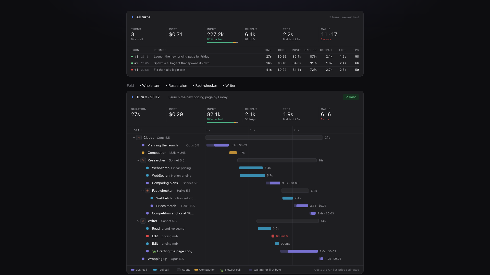

# trace-waterfall

[English](README.md) · **中文**

一個 Claude Code 的 mod：在對話旁邊開一個 **Trace** 面板，把每一輪（turn）裡的 LLM 呼叫、工具呼叫、subagent（以及 subagent 的 subagent）即時畫成瀑布圖，並統計 token、TTFT、TPS 與估算成本。



🎬 介紹影片（英文）：[media/intro.mp4](media/intro.mp4)（畫面由 mod 本身的 SVG 繪製程式產生，數字是示範資料）

## 功能

- **即時瀑布圖**：每個 span 一列，依時間軸排開；正在跑的 bar 會持續長大，subagent 以縮排呈現巢狀關係。
- **等待 vs. 串流**：LLM bar 的淡色段是等第一個 byte 的時間，實色段是開始串流之後。
- **Token 拆分**
  - Input：uncached / cache read / cache write，附 cached 比例與分段色條。
  - Output：output token 數與串流速度（tok/s）。
- **TTFT**：第一個 byte 的平均時間，以及第一段可見文字（或工具呼叫）的時間。
- **呼叫數與錯誤**：LLM · tool 呼叫次數，失敗的呼叫列出錯誤訊息（去掉 `<tool_use_error>` 等標籤）。
- **最慢的呼叫**：這一輪最慢的呼叫，名稱前面會有一隻 🐢。
- **壓縮 context**：壓縮會以琥珀色 bar 畫在它發生的位置（正在跑的 turn 裡、發生壓縮的那個 loop 底下），並標出壓縮前後的對話大小（`182k → 24k`）；在兩輪之間執行的 `/compact` 會有自己的一張卡片。壓縮本身的 token 與成本會算進那一輪。
- **一輪一張卡片**：每個 turn 累積成一張卡片，最新的在最上面；新的 turn 開始 Live 時，已完成的 turn 自動收合（只收一次，手動展開的不會再被收回）。
- **總表**：最上面是所有 turn 的統計與一覽表（時間、成本、input、cached、output、TTFT、TPS）。
- **Reset**：清掉已完成的 turn，正在跑的保留。
- **收合分支**：每張卡片最上面的 **Fold** 按鈕可以收合整個 turn 或任一個 subagent，被收合的子呼叫會以色塊疊在父列上。
- **細節**：在終端機與 VS Code 按一列，展開那個 span 的輸入、輸出、token、TTFT、串流時間與錯誤。
- **背景 subagent**：Agent 呼叫回傳後還在跑的 subagent 會持續 Live，直到它自己的 turn 結束；turn 中斷時沒跑完的呼叫會標成 Interrupted。
- **各種介面**：桌面版與手機上畫成可縮放的 SVG；終端機與 VS Code 畫成文字列。

成本是依官方 API 牌價估算的「API 等價」金額；用訂閱方案的話實際計費方式不同。

## 安裝

從 shell：

```bash
claude plugin marketplace add linfengwei/claude-code-trace-waterfall
claude plugin install trace-waterfall@trace-waterfall
```

或在終端機的 Claude Code 提示列輸入：

```
/plugin marketplace add linfengwei/claude-code-trace-waterfall
/plugin install trace-waterfall@trace-waterfall
```

桌面版 App 和 CLI 共用同一套 plugin，在任何終端機執行上面的 shell 指令即可。裝好後開一個新 session（或重開 Claude Code），pane 就會載入。

## 更新

```bash
claude plugin update trace-waterfall@trace-waterfall
```

會從 GitHub 抓最新版本。更新後開一個新 session（或重開 Claude Code）才會載入。

## 使用

- 在桌面版、手機與 VS Code，面板會在 session 開始時自動打開；在終端機輸入 `/trace` 打開（任何地方都可以用 `/trace` 重新打開）。
- 在面板上：
  - **Reset** 清掉已完成的 turn。
  - 每張卡片最上面的 **Fold** 按鈕收合或展開分支。

## 開發

```bash
claude --plugin-dir /path/to/trace-waterfall
```

```bash
claude plugin validate .
```

```bash
claude plugin test .
```

## 檔案結構

| 檔案 | 內容 |
| --- | --- |
| `hooks/register.tsx` | 所有 hook：記錄 turn、LLM 串流、工具、subagent，並繪製面板 |
| `hooks/svg.ts` | 桌面與手機用的 SVG 繪製（總表、瀑布圖、統計卡） |
| `hooks/model.ts` | 價格表、格式化、顏色、時間軸 |
| `types/index.d.ts` | `$.state` 的型別合約 |
| `tests/trace.test.tsx` | 各介面、歷史、背景 subagent、壓縮 context、超大 turn 的測試 |

## 限制

- Claude Code 傳給 mod 的 usage 只有 input、output、cache read 與 cache write，沒有 thinking token 數，所以不顯示 thinking。
- 一張卡片的 SVG 上限是 131072 字元。turn 太大時只畫根節點與最新的列，並標示有幾列沒畫；收合分支就能看到其他列。
- 最多保留 30 個 turn。
